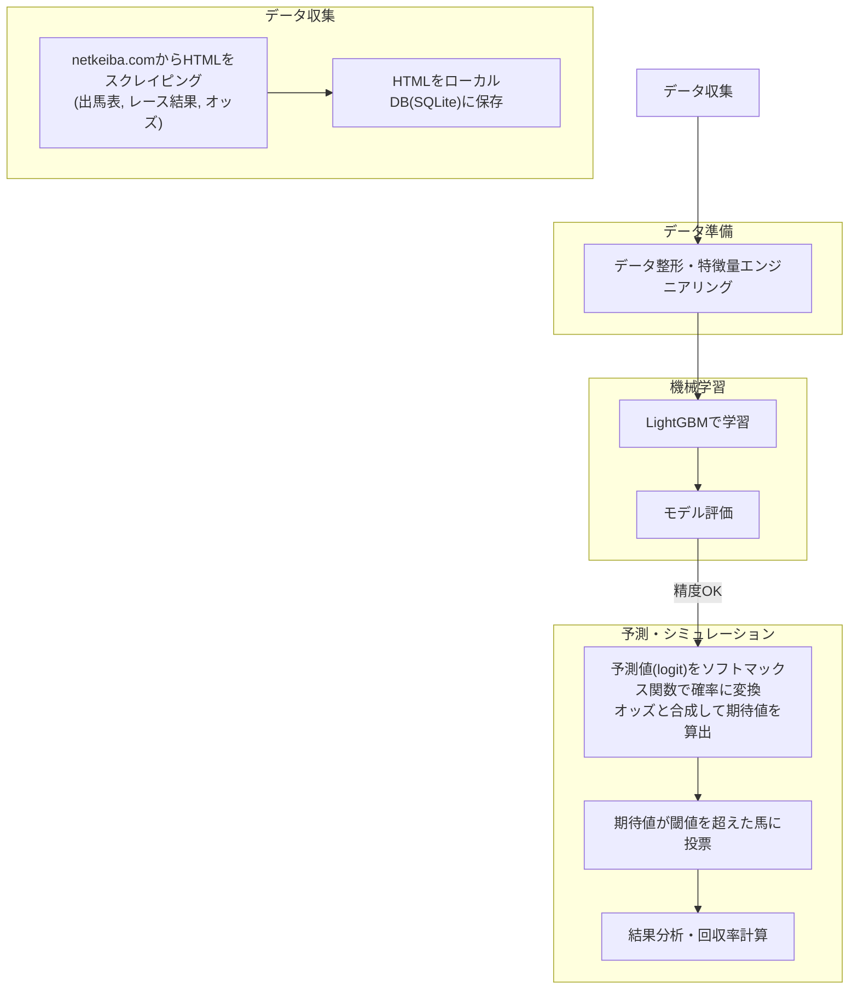

# 競馬AI予想システム構築プロジェクト

## 1. プロジェクト目標

開発するAI予想システムを用いて、競馬における投票の回収率100%超を達成し、継続的な利益を生み出すことを目指す。

## 2. システム概要

netkeiba.comから取得した過去のレースデータとオッズ情報を利用して、機械学習モデル（LightGBM）を構築する。このモデルを用いて未来のレースにおける各馬の勝率を予測し、期待値の高い馬券を自動で特定する。シミュレーションと実運用を通じて、システムの有効性を検証し、改善を繰り返す。

### 処理フロー



## 3. 機能要件

### 3.1. データ収集機能
- **機能:** 指定された期間やレースIDに基づき、netkeiba.comから関連データ（出馬表、レース結果、オッズ）をスクレイピングする。
- **実装方針:**
    - サイトへの負荷を考慮し、取得したHTMLはまずローカルのSQLiteデータベースに保存する。
    - 解析処理は保存されたHTMLに対して行う。

### 3.2. データ整形・特徴量エンジニアリング機能
- **機能:** データベースに保存されたHTMLをパースし、構造化データ（Polars DataFrame）に変換する。
- **実装方針:**
    - `raceresult`テーブル、`horse`テーブルのように正規化された形式でデータを管理する。
    - カテゴリカル変数のエンコーディング、欠損値処理などを行う。
    - 血統、騎手、コース適性、過去の成績などから有効な特徴量を生成する。

### 3.3. モデル学習・評価機能
- **機能:** 整形済みデータを用いてLightGBMモデルの学習と評価を行う。
- **実装方針:**
    - 目的変数を「着順」などとした多クラス分類モデルを構築する。
    - 学習済みモデルはシリアライズして保存する。
    - 回収率、的中率、ROC-AUCなどの指標でモデルの性能を評価する。

### 3.4. 予測・シミュレーション機能
- **機能:** 学習済みモデルを使い、開催予定のレースについて各馬の予測確率と期待値を算出する。
- **実装方針:**
    - モデルの出力（logit）をソフトマックス関数で確率に変換する。
    - 取得したオッズと予測確率から期待値を計算する。
    - 期待値が指定した閾値を超えた馬券の組み合わせを特定し、その結果（回収率など）をシミュレートする。

### 3.5. 運用機能
- **継続的学習:** 新しいレース結果を定期的に収集し、モデルを自動で再学習・更新するワークフローを構築する。
- **レース予測:** 開催予定のレース情報を入力とし、投票推奨の馬と買い目を提示するインターフェース（CLIなど）を提供する。
- **✅ 実装状況 (2026-02):** CLIインターフェース (`cli.py`) を実装済み。以下のコマンドが利用可能:
    - `update`: データ収集・更新
    - `train`: モデル学習 (Optuna最適化オプション付き)
    - `forecast`: 未来レースの予測 (出馬表取得・予測)
    - `simulate`: バックテストシミュレーション (ROI評価)
    - `status`: データベースステータス確認

## 4. 実装方針
1.  **フェーズ1: プロトタイピング**
    - モックデータ（固定のCSVファイルなど）を用いて、データ整形からシミュレーションまでのパイプラインを一気通貫で実装する。
    - まずはシステム全体の骨格を完成させ、各機能が連携して動作することを確認する。

2.  **フェーズ2: 本実装**
    - プロトタイプで作成した各コンポーネント（データ収集、DB連携など）を、実際のロジックに置き換えていく。
    - 過去に作成したコード資産を参考にし、効率的に実装を進める。

## 5. 技術スタック
- **プログラミング言語:** Python 3.12+
- **パッケージ管理:** `uv`
- **コード静的解析/フォーマット:** `Ruff`
- **データ処理:** `Polars`
- **機械学習:** `LightGBM`, `scikit-learn`
- **データベース:** `SQLite`
- **Webスクレイピング:** `BeautifulSoup4`, `httpx` (or `requests`)

## 6. 今後の課題・検討事項

- **[x] スクレイピングの法的・倫理的側面:**
    - **利用目的の限定:**
        - 取得したデータは、AI予想システムの学習・検証を目的とした個人利用に限定し、外部への公開や商業利用は一切行わないものとします。
    - **サーバー負荷への最大限の配慮:**
        - スクレイピング時には、必ずHTTPリクエスト間に十分な遅延（最低でも5秒以上の`time.sleep()`）を設けます。
        - 短時間での連続アクセスや、過度な並行処理は行いません。
        - 万が一、サイト側からアクセス制限や警告があった場合は、直ちにスクレイピングを中止し、状況を調査し、適切な対応を行います。
    - **必要最小限のデータ取得:**
        - システムに必要な情報のみをピンポイントで取得し、サイト全体を網羅的にクロールするような行為は避けます。
    - **適切なUser-Agentの設定:**
        - HTTPリクエストには、一般的なブラウザの`User-Agent`（例: `Mozilla/5.0 (Windows NT 10.0; Win64; x64) AppleWebKit/537.36 (KHTML, like Gecko) Chrome/91.0.4472.124 Safari/537.36`など）を設定します。
- **[x] 特徴量エンジニアリングの深化:**
    - モデルの予測精度向上に寄与する以下の特徴量を生成します。
    - **1. 基本的な特徴量（生データから直接利用）:**
        - **レース情報:** `distance`, `course_type`, `course_direction`, `track_condition`, `weather`, `race_grade`, `start_time` (時間帯をカテゴリや数値に変換), `num_of_runners`, `prize_money_1st` など。
        - **出走馬情報（レースごとの動的データ）:** `weight_carried`, `bracket_number`, `horse_number`, `horse_weight`, `horse_weight_diff`。
        - **リーク扱い（学習・評価に使用しない）:** `odds_win`, `popularity` はレース前に入手不可能とみなす。
        - **馬固有情報:** `sex`。
    - **2. 派生特徴量（既存データから計算・加工）:**
        - **馬の年齢 (`age_at_race_years`, `age_at_race_days`):**
            - **データソース:** `horses.birth_date`, `races.race_date`
            - **生成方法:** レース開催日 (`races.race_date`) から馬の生年月日 (`horses.birth_date`) を引いて、年数と日数を計算。
            - **データ型:** INTEGER (年数), INTEGER (日数)
        - **騎手経験年数 (`jockey_experience_years`, `jockey_experience_days`):**
            - **データソース:** `jockeys.debut_date`, `races.race_date`
            - **生成方法:** レース開催日 (`races.race_date`) から騎手のデビュー年月日 (`jockeys.debut_date`) を引いて、年数と日数を計算。
            - **データ型:** INTEGER (年数), INTEGER (日数)
        - **前走からの間隔 (`days_since_last_race`):**
            - **データソース:** `results`テーブル (過去のレース結果), `races.race_date`
            - **生成方法:** 対象の馬の直前のレースの`race_date`と現在のレースの`race_date`の差分を日単位で計算。
            - **データ型:** INTEGER
        - **馬の特定条件での過去成績 (`horse_avg_rank_same_dist_past_1y`, `horse_win_rate_same_course_type_past_3m` など):**
            - **データソース:** `results`テーブル, `races`テーブル
            - **生成方法:** 対象の馬の過去レース結果から、集計期間（例: 過去1年間、直近3ヶ月、過去N走）や特定の条件（同距離、同コースタイプ、同競馬場、同馬場状態など）でフィルタリングし、平均着順、勝率、連対率、複勝率などを計算。
            - **データ型:** REAL (0.0〜1.0) または REAL (平均着順)
        - **騎手・調教師の特定条件での過去成績 (`jockey_win_rate_same_course`, `trainer_avg_rank_same_course_type` など):**
            - **データソース:** `results`テーブル, `races`テーブル
            - **生成方法:** 対象の騎手または調教師の過去レース結果から、集計期間や特定の条件でフィルタリングし、勝率、連対率、複勝率、平均着順などを計算。
            - **データ型:** REAL (0.0〜1.0) または REAL (平均着順)
        - **血統的適性 (Sire/DamSire_Avg_WinRate_Same_Dist):**
            - **データソース:** `horses`テーブル, `results`テーブル, `races`テーブル
            - **生成方法:** 対象の馬の父馬または母父馬の産駒の過去レース結果から、特定の条件（今回の距離、コースタイプなど）での平均勝率や平均着順を計算。
            - **データ型:** REAL (0.0〜1.0) または REAL (平均着順)

- **[x] データベーススキーマ設計:**
    - `races`, `results`, `horses`, `jockeys`などのテーブル構成を設計します。
    - **`races`テーブル スキーマ案:**
        | カラム名             | データ型 | 制約     | 説明                                      |
        | :------------------- | :------- | :------- | :---------------------------------------- |
        | `race_id`            | TEXT     | PRIMARY KEY | netkeiba.comのレースID                     |
        | `race_name`          | TEXT     | NOT NULL | レース名                                  |
        | `race_date`          | TEXT     | NOT NULL | 開催日 (例: `YYYY-MM-DD`)                 |
        | `start_time`         | TEXT     | NOT NULL | 発走時刻 (例: `HH:MM`)                    |
        | `course_name`        | TEXT     | NOT NULL | 競馬場名 (例: `東京`, `中山`)             |
        | `distance`           | INTEGER  | NOT NULL | 距離 (メートル単位, 例: `1600`)           |
        | `course_type`        | TEXT     | NOT NULL | コースの種類 (例: `芝`, `ダート`, `障害`) |
        | `course_direction`   | TEXT     | NOT NULL | コースの回り方 (例: `右`, `左`, `直`, `左右`, `外`) |
        | `track_condition`    | TEXT     | NOT NULL | 馬場状態 (例: `良`, `稍重`, `重`, `不良`) |
        | `weather`            | TEXT     | NOT NULL | 天候 (例: `晴`, `曇`, `雨`, `小雨`, `雪`) |
        | `race_number`        | INTEGER  | NOT NULL | レース番号 (例: `1`, `2`)                 |
        | `race_grade`         | TEXT     |          | レースグレード (例: `G1`, `新馬`, `国際`) |
        | `num_of_runners`     | INTEGER  | NOT NULL | 出走頭数                                  |
        | `prize_money_1st`    | INTEGER  |          | 1着賞金 (万円単位)                        |
        | `prize_money_2nd`    | INTEGER  |          | 2着賞金 (万円単位)                        |
        | `prize_money_3rd`    | INTEGER  |          | 3着賞金 (万円単位)                        |
        | `prize_money_4th`    | INTEGER  |          | 4着賞金 (万円単位)                        |
        | `prize_money_5th`    | INTEGER  |          | 5着賞金 (万円単位)                        |
    - **`owners`テーブル スキーマ案:**
        | カラム名    | データ型 | 制約        | 説明                   |
        | :---------- | :------- | :---------- | :--------------------- |
        | `owner_id`  | TEXT     | PRIMARY KEY | netkeiba.comの馬主ID   |
        | `owner_name`| TEXT     | NOT NULL    | 馬主名                 |
    - **`trainers`テーブル スキーマ案:**
        | カラム名     | データ型 | 制約        | 説明                     |
        | :----------- | :------- | :---------- | :----------------------- |
        | `trainer_id` | TEXT     | PRIMARY KEY | netkeiba.comの調教師ID   |
        | `trainer_name`| TEXT     | NOT NULL    | 調教師名                 |
    - **`producers`テーブル スキーマ案:**
        | カラム名      | データ型 | 制約        | 説明                     |
        | :------------ | :------- | :---------- | :----------------------- |
        | `producer_id` | TEXT     | PRIMARY KEY | netkeiba.comの生産者ID   |
        | `producer_name`| TEXT     | NOT NULL    | 生産者名                 |
    - **`breeding_farms`テーブル スキーマ案:**
        | カラム名          | データ型 | 制約        | 説明                     |
        | :---------------- | :------- | :---------- | :----------------------- |
        | `breeding_farm_id`| TEXT     | PRIMARY KEY | netkeiba.comの生産牧場ID |
        | `breeding_farm_name`| TEXT     | NOT NULL    | 生産牧場名               |
    - **`horses`テーブル スキーマ案 (正規化後):**
        | カラム名            | データ型 | 制約                                | 説明                       |
        | :------------------ | :------- | :---------------------------------- | :------------------------- |
        | `horse_id`          | TEXT     | PRIMARY KEY                         | netkeiba.comの馬ID         |
        | `horse_name`        | TEXT     | NOT NULL                            | 馬名                       |
        | `sex`               | TEXT     | NOT NULL                            | 性別 (例: `牡`, `牝`, `せん`) |
        | `birth_date`        | TEXT     | NOT NULL                            | 生年月日 (例: `YYYY-MM-DD`)|
        | `sire_id`           | TEXT     | FOREIGN KEY (`horses.horse_id`)     | 父馬のID (馬自身を指す)    |
        | `dam_id`            | TEXT     | FOREIGN KEY (`horses.horse_id`)     | 母馬のID (馬自身を指す)    |
        | `dam_sire_id`       | TEXT     | FOREIGN KEY (`horses.horse_id`)     | 母父馬のID (馬自身を指す)  |
        | `owner_id`          | TEXT     | FOREIGN KEY (`owners.owner_id`)     | 馬主ID                     |
        | `trainer_id`        | TEXT     | FOREIGN KEY (`trainers.trainer_id`) | 調教師ID                   |
        | `producer_id`       | TEXT     | FOREIGN KEY (`producers.producer_id`) | 生産者ID                   |
        | `breeding_farm_id`  | TEXT     | FOREIGN KEY (`breeding_farms.breeding_farm_id`) | 生産牧場ID                 |
    - **`jockeys`テーブル スキーマ案:**
        | カラム名            | データ型 | 制約     | 説明                       |
        | :------------------ | :------- | :------- | :------------------------- |
        | `jockey_id`         | TEXT     | PRIMARY KEY | netkeiba.comの騎手ID       |
        | `jockey_name`       | TEXT     | NOT NULL | 騎手名                     |
        | `birth_date`        | TEXT     |          | 生年月日 (例: `YYYY-MM-DD`)|
        | `birth_place`       | TEXT     |          | 出身地 (例: `北海道`, `東京都`) |
        | `belonging`         | TEXT     |          | 所属 (例: `栗東`, `美浦`, `地方`) |
        | `debut_date`        | TEXT     |          | デビュー年月日 (例: `YYYY-MM-DD`) |
        | `license_type`      | TEXT     |          | 免許区分 (例: `平地`, `障害`) |

    - **`results`テーブル スキーマ案:**
        | カラム名            | データ型 | 制約                                | 説明                       |
        | :------------------ | :------- | :---------------------------------- | :------------------------- |
        | `race_id`           | TEXT     | PRIMARY KEY, FOREIGN KEY (`races.race_id`) | レースID                   |
        | `horse_id`          | TEXT     | PRIMARY KEY, FOREIGN KEY (`horses.horse_id`) | 馬ID                       |
        | `jockey_id`         | TEXT     | FOREIGN KEY (`jockeys.jockey_id`)   | 騎手ID                     |
        | `trainer_id`        | TEXT     | FOREIGN KEY (`trainers.trainer_id`) | 調教師ID                   |
        | `owner_id`          | TEXT     | FOREIGN KEY (`owners.owner_id`)     | 馬主ID                     |
        | `rank`              | INTEGER  | NOT NULL                            | 着順 (例: `1`, `2`, `3`)   |
        | `bracket_number`    | INTEGER  | NOT NULL                            | 枠番 (例: `1`〜`8`)        |
        | `horse_number`      | INTEGER  | NOT NULL                            | 馬番 (例: `1`〜`18`)       |
        | `sex_age`           | TEXT     | NOT NULL                            | 性齢 (例: `牡3`, `牝4`)    |
        | `weight_carried`    | REAL     | NOT NULL                            | 斤量 (Kg)                  |
        | `distance_diff`     | REAL     |                                     | 走破タイム差 (秒)          |
        | `last_3f_time`      | REAL     |                                     | 上がり3ハロンタイム (秒)   |
        | `odds_win`          | REAL     |                                     | 単勝オッズ (レース結果前の最終オッズ) |
        | `popularity`        | INTEGER  |                                     | 単勝人気 (例: `1`番人気)   |
        | `horse_weight`      | INTEGER  |                                     | 馬体重 (Kg)                |
        | `horse_weight_diff` | INTEGER  |                                     | 馬体重増減 (Kg)            |

- **[x] モデルの改善サイクル:**
    - **1. ハイパーパラメータチューニング:**
        - **ツール:** `Optuna`を使用し、ベイズ最適化などの効率的な探索戦略で最適なハイパーパラメータを見つけます。
        - **目的変数と評価指標:**
            - **クラス設計:** 着順を以下の4クラスに分類します。
                - クラス0: 1着
                - クラス1: 2着
                - クラス2: 3着
                - クラス3: 4着以下
            - **主指標:** `Multi-class LogLoss` (多クラス対数損失) を用いて、モデルの予測確率の確からしさを最大化します。
        - **検証方法:** 過去データで学習し未来データで評価する「時系列クロスバリデーション」を採用します。データリークを防ぐため`PurgedGroupKFold`のような手法を検討します。
        - **探索範囲と計算コスト:** `n_estimators`, `learning_rate`, `num_leaves`, `max_depth`などLightGBMの主要パラメータを対象とし、初期段階では100〜200回程度の試行から開始します。Optunaのプルーニング機能で効率化を図ります。
        - **回収率の評価:** チューニングは`LogLoss`で行いますが、最終的なモデル選定時にはシミュレーションを通じて回収率が最も高くなるような閾値を見つけ、その回収率でモデルを評価します。
    - **2. 新しいデータによる追加学習（再学習）:**
        - **頻度:** 毎週新しいレース結果を収集し、モデルの更新を行うことを目指します。
        - **方法:** 基本的には、全ての過去データ（蓄積された全レースデータ）を使ってモデルをゼロから再学習させる「Full Retraining」を方針とします。これにより、最も頑健で最新のトレンドを反映したモデルを常に構築します。
        - **実行トリガー:** 定期的なバッチ処理（例: 毎週月曜日の早朝など）として自動で実行されるよう、スケジュールされたタスクを設定します。
    - **3. ランキング学習の段階的導入:**
        - まずは4クラス分類モデルで基本的な予測パイプラインを確立し、回収率のベースラインを把握します。
        - その後、モデルの改善フェーズで、より高度な手法として**ランキング学習 (LightGBMの`lambdarank`など)** を導入し、多クラス分類モデルと比較・検討することで、さらなる回収率向上を目指します。
- **[x] プロジェクト構成:**
    - `src`ディレクトリの構成、設定ファイルの管理方法などを定める。

## 7. プロジェクト構成案

一般的なPythonプロジェクトのベストプラクティスに基づき、以下のディレクトリ構成案を提案します。各機能が独立して開発・テストしやすいようにモジュール化されており、将来的な拡張性も考慮しています。

```
umabozu/
├── .env                  # 環境変数 (DB接続情報など、git管理外)
├── .gitignore            # Gitで管理しないファイル/ディレクトリの指定
├── pyproject.toml        # プロジェクトのメタデータ、依存関係、ruffなどのツール設定
├── README.md             # プロジェクトの概要、セットアップ方法など
├── cli.py                # CLIアプリケーションのエントリーポイント（メインインターフェース）
│
├── src/
│   └── umabozu/          # プロジェクトのPythonパッケージ
│       ├── __init__.py   # パッケージ初期化ファイル
│       │
│       ├── config.py             # アプリケーション全体の設定管理
│       │
│       ├── database/             # データベース関連モジュール
│       │   ├── __init__.py
│       │   ├── schema.py         # DBスキーマ定義 (テーブル作成SQLなど)
│       │   ├── crud.py           # DB操作 (データの挿入、取得など)
│       │   └── models.py         # ORM利用時のモデル定義
│       │
│       ├── data_collection/      # データ収集（スクレイピング）関連
│       │   ├── __init__.py
│       │   ├── scraper.py        # netkeiba.comからのHTML取得ロジック
│       │   └── html_parser.py    # 取得したHTMLの解析ロジック
│       │
│       ├── data_preprocessing/   # データ整形・特徴量エンジニアリング関連
│       │   ├── __init__.py
│       │   ├── preprocessor.py   # データクリーニング、型変換など
│       │   └── feature_engineer.py # 特徴量生成ロジック
│       │
│       ├── models/               # 機械学習モデル関連
│       │   ├── __init__.py
│       │   ├── trainer.py        # LightGBMモデルの学習ロジック
│       │   ├── predictor.py      # 学習済みモデルによる予測ロジック
│       │   └── evaluation.py     # モデル評価ロジック
│       │
│       └── simulation/           # 予測・シミュレーション関連
│           ├── __init__.py
│           ├── odds_calculator.py  # オッズと予測確率から期待値を計算
│           └── bet_simulator.py    # 投票シミュレーションロジック
│
├── tests/                # テストコード
│   ├── __init__.py
│   ├── test_database.py
│   ├── test_scraper.py
│   ├── test_preprocessing.py
│   └── test_models.py
│
├── data/                 # データファイル格納場所
│   ├── raw/              # スクレイピングで取得した生HTMLファイルなど
│   ├── processed/        # 整形・特徴量生成後のデータファイル (例: Parquetファイル)
│   └── external/         # 外部から取得したデータなど
│
├── trained_models/       # 学習済みモデルファイル (.pkl, .lgbなど)
│
└── notebooks/            # Jupyter Notebooks (データ分析、実験、プロトタイピングなど)
